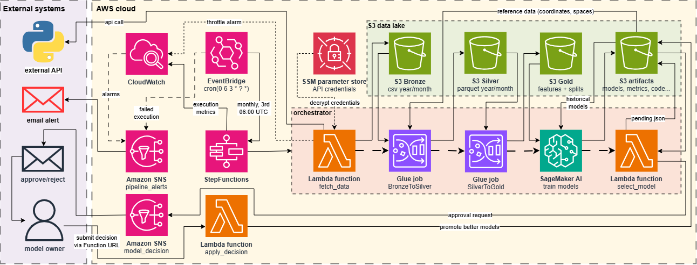
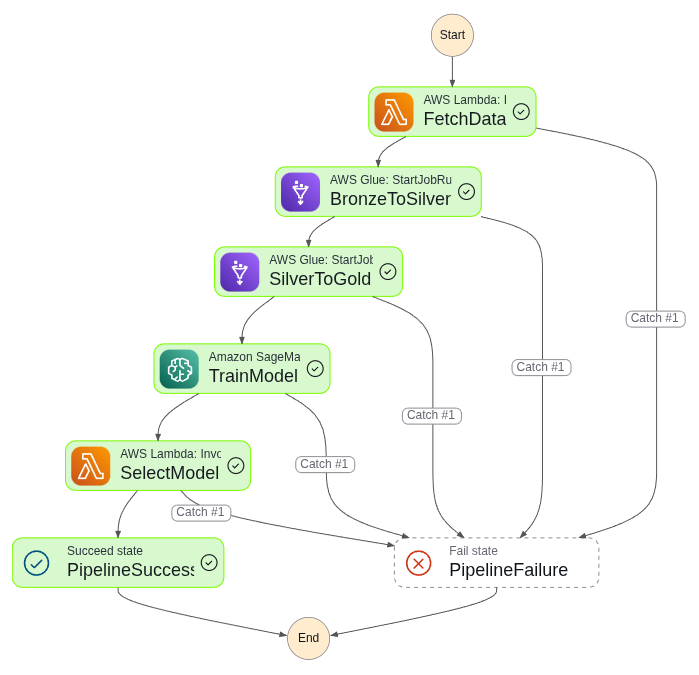
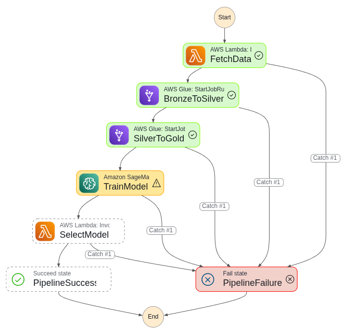
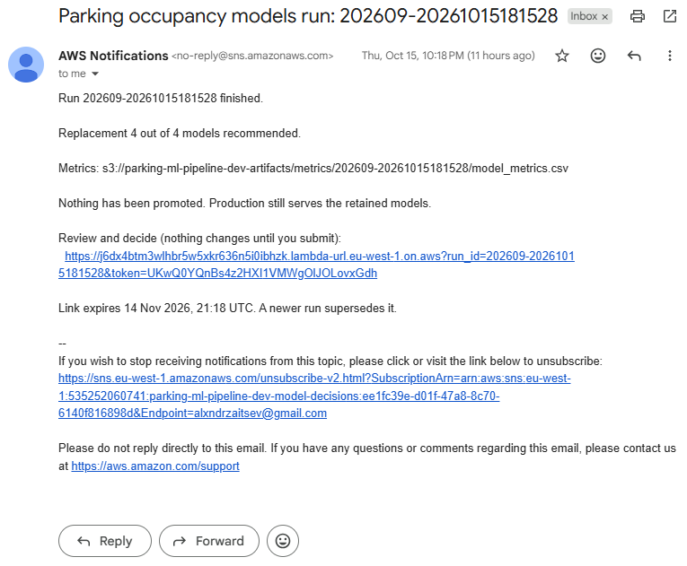
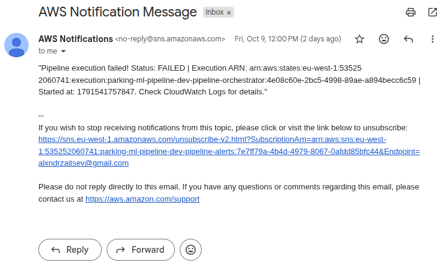
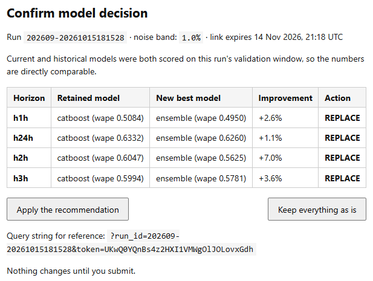
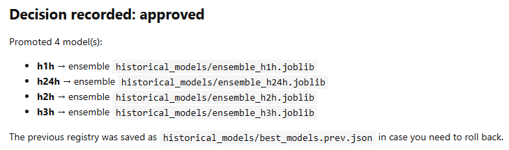
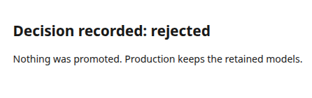
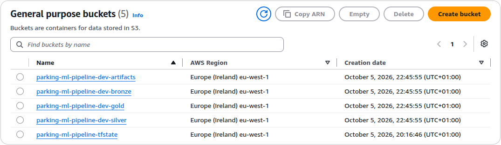

[](https://github.com/alxndrztsv/aws-parking-occupancy-prediction-model/actions/workflows/ci.yml) [](https://github.com/alxndrztsv/aws-parking-occupancy-prediction-model/actions/workflows/cd.yml)

# AWS Parking Occupancy Prediction

A monthly, fully automated ML pipeline that predicts **parking occupancy** at Irish
parking terminals one, two, three and twenty-four hours ahead. Raw transactions are
pulled from the operator's HTTP API, processed through a medallion lakehouse on
Spark, and sixteen gradient-boosted models are trained in a single SageMaker job.
The winning model per horizon is **not** deployed automatically — the pipeline
emails a comparison and waits for a human decision behind a signed link.

## What it predicts

|           |                                                                                                                                                                                                             |
| --------- | ----------------------------------------------------------------------------------------------------------------------------------------------------------------------------------------------------------- |
| Target    | `occupancy_rate` = active sessions / total spaces, per terminal, per 10-minute bin                                                                                                                          |
| Horizons  | `h1h`, `h2h`, `h3h`, `h24h` (60 / 120 / 180 / 1440 minutes ahead)                                                                                                                                           |
| Features  | 24 — lags at 10/20/30/60/120/180 min, same time 1/7/14 days back, a 7-day same-time mean, rolling mean and std over 1/2/3 h, the live occupancy state, calendar fields, terminal capacity and a terminal id |
| Models    | LightGBM, XGBoost, CatBoost and an equal-weight blend of the three, per horizon → **16 artifacts**                                                                                                          |
| Selection | lowest **validation WAPE**, with a 1% noise band so near-ties do not churn the production set                                                                                                               |

MAE is reported but never used to rank across horizons: longer horizons have a lower
mean target and a larger share of zero-occupancy rows, so MAE is not comparable
between them. MASE uses the in-sample seasonal-naive MAE **of the same horizon** as
its denominator, which makes MASE the one metric that is comparable everywhere —
`MASE < 1` means the model beats "whatever happened at this time yesterday".

## Architecture

<p align="center">
  <a href="https://raw.githubusercontent.com/alxndrztsv/aws-parking-occupancy-prediction-model/main/docs/architecture_diagram.png" target="_blank">
    
  </a>
  <br>
  <em>End-to-end ML pipeline architecture.</em>
</p>

1. **Fetch** — EventBridge fires on the 3rd of each month at 06:00 UTC. A Lambda
   resolves the previous calendar month, calls the operator API with credentials from
   SSM Parameter Store, and streams the response straight into Bronze
   (`year=…/month=…/transactions.csv`) without buffering it in memory.
2. **Bronze → Silver** — Glue (PySpark) parses and validates the raw CSV, casts to
   typed columns, drops duplicates on `system_id`, and enriches each terminal with
   coordinates and capacity from a reference join.
3. **Silver → Gold** — a second Glue job builds a gap-free 10-minute grid per terminal
   (sessions open before midnight and close after it are clipped to the day, so no
   bin is ever double-counted), derives all 24 features plus the four horizon targets
   with Spark window functions, and writes time-based train / valid / test splits.
4. **Train** — one SageMaker job reads the three splits and fits all 16 models.
   Baselines are scored first so every model has something to beat.
5. **Select** — a Lambda compares this run's best against the currently retained model,
   writes a pending decision to S3 and emails the comparison.
6. **Decide** — a second Lambda behind a Function URL renders the decision page and,
   only on an explicit POST, promotes the winner into `historical_models/`.
7. **Alerting** — any failed, timed-out or aborted execution is published to SNS and
   emailed.

## The interesting part: comparable evaluation

Two design decisions do most of the work here.

**Retained models are re-scored, not trusted.** Each monthly run derives its split
boundaries from `max(timestamp)`, so "the validation set" is a _different_ 60-day
window every month. Comparing a WAPE stored last month against one computed today
would mostly measure which period was easier. Instead the training job downloads the
retained bundles and scores them on **this** run's validation split, so both sides of
the comparison come from the same rows. A bundle whose feature schema has drifted, or
that will not unpickle under newer library versions, is skipped with a log line rather
than failing a multi-hour job.

**Promotion is a human decision.** `historical_models/best_models.json` is not touched
by the pipeline. Ignoring the email is safe: production keeps serving the retained
models, and the next run simply compares against the same models again. The link
carries a single-use random token stored next to the decision, expires after 30 days,
and is superseded by any newer run. `GET` only renders the page, the promotion
happens on `POST` because mail-security scanners follow links automatically and an
email should not be able to approve itself.

## Pipeline execution

<table>
  <tr>
    <th width="50%">✅ Successful execution</th>
    <th width="50%">🚨 Failed execution</th>
  </tr>
  <tr>
    <td>
      <a href="https://raw.githubusercontent.com/alxndrztsv/aws-parking-occupancy-prediction-model/main/docs/step_functions_success.png" target="_blank">
        
      </a>
    </td>
    <td>
      <a href="https://raw.githubusercontent.com/alxndrztsv/aws-parking-occupancy-prediction-model/main/docs/step_functions_failure.png" target="_blank">
        
      </a>
    </td>
  </tr>
  <tr>
    <td><em>All five stages complete; a decision email is on its way.</em></td>
    <td><em>Any stage failing publishes to SNS and emails the execution ARN.</em></td>
  </tr>
</table>

The state machine ends at `PipelineSuccess` or `PipelineFailure`. On success the
decision email is queued as soon as the execution finishes; the machine never waits
for the human. There is no `waitForTaskToken`, so a decision that takes three weeks
cannot time out an execution or trip the failure alarm.

<table>
  <tr>
    <th width="50%">✅ Successful execution email</th>
    <th width="50%">🚨 Failure alert (SNS)</th>
  </tr>
  <tr>
    <td>
      <a href="https://raw.githubusercontent.com/alxndrztsv/aws-parking-occupancy-prediction-model/main/docs/email_success.png" target="_blank">
        
      </a>
    </td>
    <td>
      <a href="https://raw.githubusercontent.com/alxndrztsv/aws-parking-occupancy-prediction-model/main/docs/email_alert.png" target="_blank">
        
      </a>
    </td>
  </tr>
  <tr>
    <td><em>A decision email after successful execution of Step Functions.</em></td>
    <td><em>Alert triggered by the EventBridge failure rule.</em></td>
  </tr>
</table>

<details>
  <summary>📂 Click to view apply decision email</summary>
  <br>
  <p align="center">
    <a href="https://raw.githubusercontent.com/alxndrztsv/aws-parking-occupancy-prediction-model/main/docs/apply_decision.png" target="_blank">
      
    </a>
    <br>
    <em>Result email from <code>lambda_apply_decision.py</code> Lambda Function.</em>
  </p>
  <br>
  <table>
    <tr>
      <th width="50%">✅ Decision approved</th>
      <th width="50%">❌ Decision rejected</th>
    </tr>
    <tr>
      <td>
        <a href="https://raw.githubusercontent.com/alxndrztsv/aws-parking-occupancy-prediction-model/main/docs/decision_approval.png" target="_blank">
          
        </a>
      </td>
      <td>
        <a href="https://raw.githubusercontent.com/alxndrztsv/aws-parking-occupancy-prediction-model/main/docs/decision_rejection.png" target="_blank">
          
        </a>
      </td>
    </tr>
    <tr>
      <td><em>Decision approved - old models will be replaced with the new ones.</em></td>
      <td><em>Decision rejected - old models will be retained.</em></td>
    </tr>
  </table>
</details>

## Results

One complete monthly run — data period **September 2026**, executed 2026-10-14.
Models are selected on **validation WAPE**; the test split is held out and only
reported, so none of the numbers below were used to pick a winner.

| Horizon | Selected model | Valid WAPE | Test MAE | Test WAPE | Test MASE |
| ------- | -------------- | ---------- | -------- | --------- | --------- |
| `h1h`   | ensemble       | 0.4950     | 0.0451   | 0.5167    | 0.5514    |
| `h2h`   | ensemble       | 0.5625     | 0.0455   | 0.5845    | 0.6238    |
| `h3h`   | ensemble       | 0.5781     | 0.0397   | 0.5979    | 0.6350    |
| `h24h`  | ensemble       | 0.6260     | 0.0507   | 0.6527    | 0.5717    |

Every horizon lands at `MASE < 1` — between 36 % and 45 % less error than the
horizon-specific seasonal naive, i.e. than "whatever happened at this time
yesterday". The models retained going in were CatBoost on all four horizons; this
run recommended replacing all four, by 2.6 % / 7.0 % / 3.6 % / 1.1 % on validation
WAPE.

<!-- TODO: split sizes (train / valid / test rows) from target_profile.csv -->

The naive baselines scored on the same splits — current occupancy, same time
yesterday, same time last week — are in `baseline_metrics.csv`, and the full 20-row
table (16 candidates plus the 4 retained models re-scored on this run's validation
window) is in `model_metrics.csv`, both under `metrics/<run_id>/`.

### Runtime and cost

Measured on the same run. Glue jobs run on 2 × G.1X, training on a single
`ml.c5.4xlarge` with Managed Spot Training.

| Stage                                            | Duration       |
| ------------------------------------------------ | -------------- |
| Fetch (Lambda)                                   | 42 s           |
| Bronze → Silver (Glue, 2 × G.1X)                 | 1 min 51 s     |
| Silver → Gold (Glue, 2 × G.1X)                   | 7 min 01 s     |
| Train (SageMaker, `ml.c5.4xlarge`, Managed Spot) | 2 h 53 min     |
| Select + notify (Lambda)                         | 1 s            |
| **Total per monthly run**                        | **3 h 03 min** |

Cost does not decompose by stage — storage, log retention and the three idle weeks
between runs are not stages — so it is broken down by service instead:

| Service                                                          | Per monthly run |
| ---------------------------------------------------------------- | --------------- |
| SageMaker training (`ml.c5.4xlarge`, Managed Spot)                | ≈ $1.02         |
| Glue, S3, CloudWatch Logs, Lambda, Step Functions, SNS, EventBridge | < $0.13 combined |
| **Total**                                                        | **≈ $1.15**     |

The whole bill is one line. Training ran 2.89 h, which at the observed spend works out
to roughly $0.40 per hour against $0.82–0.98 on-demand — Managed Spot approximately
halved it, and without it the same run would cost around $2.50.

Everything else rounds to zero next to that, but none of it is actually free:

- **Glue** — 8.9 minutes of wall clock across both jobs on 2 DPU, billed per
  DPU-second, so a few cents.
- **Lambda** — 21 GB-s across two invocations, which bills at well under a tenth of a
  cent.
- **Step Functions** — five state transitions per run.
- **S3** — the only genuinely recurring cost, and it is bounded: gold is rewritten in
  place and not versioned, `current_models/` and `models/` expire after 90 days,
  bronze transitions to Standard-IA after a year.
- **CloudWatch Logs** — five log groups at 365-day retention; Spark and SageMaker emit
  most of the volume.

Nothing in the stack bills while idle, which is what keeps a monthly pipeline at about
a dollar rather than a running service.

## Tech stack

| Area                   | Technology                                                                      |
| ---------------------- | ------------------------------------------------------------------------------- |
| Infrastructure as Code | Terraform (S3 backend, native S3 state locking)                                 |
| Storage                | S3 medallion: Bronze / Silver / Gold / Artifacts                                |
| Secrets                | SSM Parameter Store (`SecureString`)                                            |
| ETL                    | AWS Glue 4.0 — PySpark 3.3, 2 × G.1X per job                                    |
| Orchestration          | Step Functions + EventBridge monthly schedule                                   |
| Training               | SageMaker Training Jobs, prebuilt scikit-learn container, Managed Spot Training |
| Models                 | LightGBM, XGBoost, CatBoost, equal-weight ensemble                              |
| Decision gate          | Lambda Function URL + SNS                                                       |
| Alerting               | SNS + EventBridge failure rules + CloudWatch alarms                             |
| CI/CD                  | GitHub Actions over OIDC — no long-lived keys                                   |
| Quality                | Ruff, pytest (129 tests), pre-commit, `terraform fmt`/`validate`                |

## Repository structure

```
.
├── glue_scripts/         # PySpark ETL: bronze→silver, silver→gold
├── lambda_functions/     # fetch_data, select_model, apply_decision
├── sagemaker/            # train.py entry point + container requirements
├── src/models/           # the training library: estimators, metrics, splits, artifacts
├── configs/models.yaml   # hyperparameters for all four model families
├── scripts/              # builds the SageMaker training archive
├── tests/                # 121 test functions
├── terraform-bootstrap/  # one-time: tfstate bucket + GitHub OIDC + deploy role
├── terraform/            # the stack (48 resource blocks over 11 files)
├── docs/                 # images used here
└── .github/workflows/    # CI (lint + test + validate), CD (plan / apply)
```

`sagemaker/train.py` and `src/` are packaged into `train.tar.gz` by
`scripts/build_sagemaker_package.sh`; the CD workflow builds and uploads it, Terraform
only points `sagemaker_submit_directory` at the key. Glue scripts, by contrast, are
plain Terraform-managed S3 objects with a content-hash `etag`, so editing one shows up
as a diff in `terraform plan`.

## Storage layout and retention

<details>
  <summary>📂 Click to view S3 bucket layout (medallion architecture)</summary>
  <br>
  <p align="center">
    <a href="https://raw.githubusercontent.com/alxndrztsv/aws-parking-occupancy-prediction-model/main/docs/s3.png" target="_blank">
      
    </a>
    <br>
    <em>Raw CSVs in Bronze (partitioned by <code>year</code>/<code>month</code>), processed Parquet in
    Silver (partitioned by <code>year</code>/<code>month</code>), Parquet features in Gold.</em>
  </p>
</details>

| Layer                                    | Keying                                                                                 | Versioning | Retention                                            |
| ---------------------------------------- | -------------------------------------------------------------------------------------- | ---------- | ---------------------------------------------------- |
| Bronze                                   | `year=…/month=…/transactions.csv`                                                      | on         | permanent; transitions to Standard-IA after 365 days |
| Silver                                   | `processed/year=…/month=…/`                                                            | on         | permanent                                            |
| Gold                                     | six fixed paths (`operational`, `continuous`, `features`, `splits/{train,valid,test}`) | **off**    | current only                                         |
| Artifacts `current_models/<run_id>/`     | per run                                                                                | on         | 90 days                                              |
| Artifacts `models/<job>/output/`         | per job                                                                                | on         | 90 days                                              |
| Artifacts `historical_models/`           | `<model>_<horizon>.joblib` — at most 16 keys                                           | on         | permanent                                            |
| Artifacts `metrics/<run_id>/`            | per run                                                                                | on         | 365 days                                             |
| Artifacts `code/`, `glue/`, `reference/` | deployed by CD / Terraform                                                             | on         | permanent                                            |

Gold is the one layer with versioning disabled, and it is deliberate: every run
rewrites the same six paths with `mode("overwrite")`, so versioning there only ever
accumulated superseded copies. Gold is also fully derived — `silver_to_gold` rebuilds
all of it from Silver in a single run — so there is nothing worth rolling back to.

## Personal data

The source feed is transaction-level parking data. `bronze_to_silver.py` does not pass
columns through: it renames the raw fields against an explicit map and then selects a
fixed allowlist of 17 operational columns, so anything the API adds later cannot reach
Silver by accident. What survives is terminal code, timestamps, durations, amount,
currency, payment method.

Gold goes further: `silver_to_gold` explodes each session into 10-minute bins and
aggregates by terminal and timestamp, so neither `system_id` nor `printed_id` reaches
the feature table. What SageMaker trains on is terminal-level occupancy rates — no row
corresponds to an individual parking session. Nothing in this repository is derived
from real records.

## CI/CD

- **CI** — on push and PR: `ruff check`, `ruff format --check`, `pytest`, then
  `terraform fmt -check`, `init -backend=false` and `validate`. No credentials needed.
- **CD** — on push to `main`: build `train.tar.gz`, upload it, and post
  `terraform plan` into the job summary. `apply` only runs from a manual
  `workflow_dispatch`, so nothing in AWS changes without an explicit click.
  Credentials come from GitHub OIDC against a role created by `terraform-bootstrap/`.
- **pre-commit** — Ruff and `terraform fmt` on commit, the test suite on push, so a red
  CI run cannot be pushed by accident.

The training archive is a build output and is gitignored; `requirements-dev.txt` pins
`pandas==2.2.3` to match the container, because CI otherwise tests against a different
pandas major than production runs.

## Testing

121 test functions, 129 collected cases. They cover the parts where a silent mistake
would be expensive:

- **Terminal-id encoding.** The one categorical feature is mapped through a
  `terminal_map` frozen at training time. A left merge widens the column to `float64`
  wherever a terminal is unseen; XGBoost matches categories by value, so leaving it
  wide would turn _every_ prediction into a missing-category one without raising. There
  is a regression test asserting the dtype survives.
- **MASE denominators.** The seasonal-naive baseline must score exactly `1.0`, which
  only holds if the denominator and the baseline are the same quantity.
- **Bundle round-trips.** Feature importance length, bundle keys, and re-scoring a
  retained bundle whose schema has drifted or which refuses to unpickle.
- **The decision gate.** `GET` must change nothing, a replayed link must be refused, a
  superseded run must be refused, and approving must write _every_ horizon into the
  registry — not only the replaced ones, or the next run loses its incumbents.
